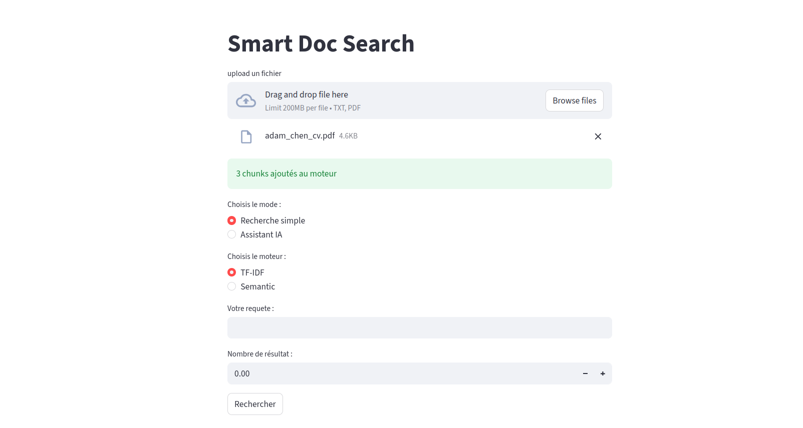
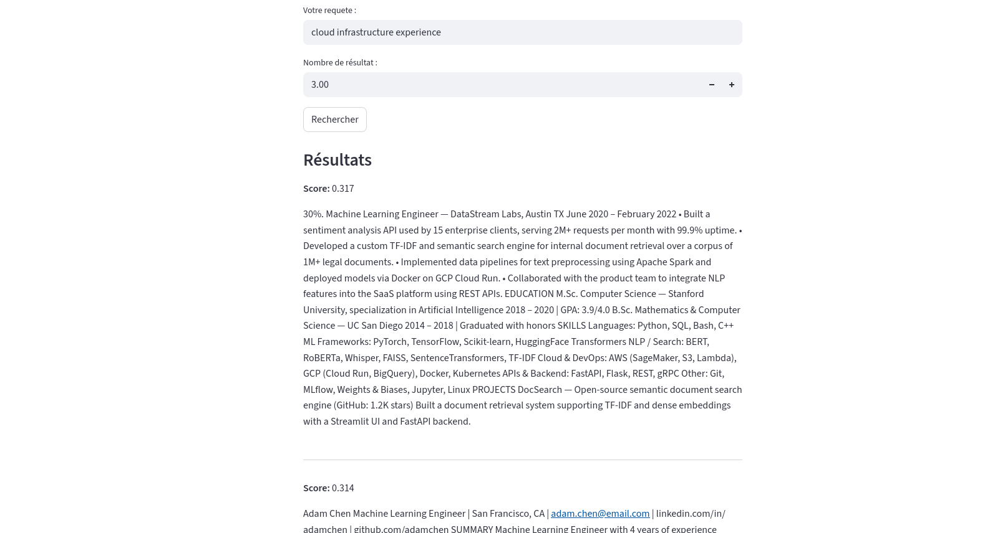
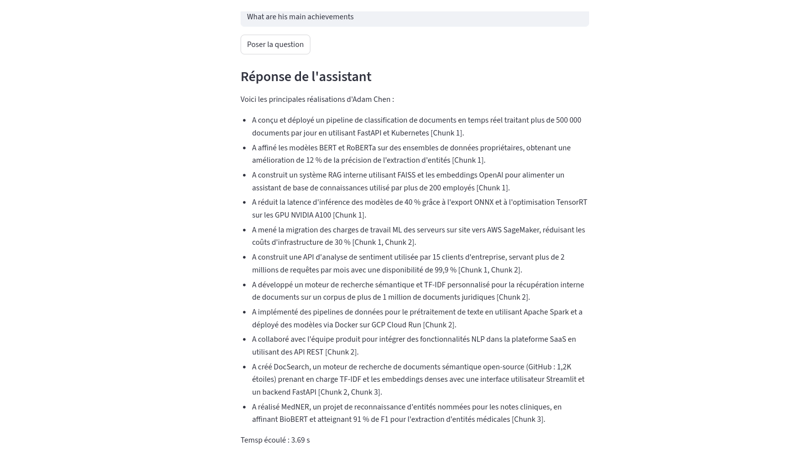

# 🔍 Smart Doc Search

A document search engine that lets you upload TXT and PDF files and query them using **TF-IDF**, **semantic search**, or a **RAG pipeline** powered by Gemini.

---

## ✨ Features

- Upload **TXT** and **PDF** files
- Choose between **TF-IDF** (keyword-based) or **Semantic** (embedding-based) search
- **RAG pipeline** powered by **Gemini API** for answer generation from retrieved chunks
- Results ranked by **relevance score** with chunk preview
- **Duplicate detection** via file hash + filename
- Clean **Streamlit** UI + **FastAPI** backend

---

## 🖼️ Screenshots

### Upload Interface


### TF-IDF Search


### Semantic Search


### AI Assistant (RAG)


---

## 🗂️ Project Structure
```
smart-doc-search/
├── app.py                  # Streamlit frontend
├── main.py                 # FastAPI entry point
├── requirements.txt
├── data/
│   └── raw/                # Sample documents
├── src/
│   ├── api/
│   │   └── main.py              # API routes
│   ├── documents/
│   │   ├── build_chunks.py      # Document chunking logic
│   │   ├── chunk_model.py       # Chunk data model
│   │   ├── read_pdf.py          # PDF reader
│   │   └── read_txt.py          # TXT reader
│   ├── preprocessing/
│   │   └── vectorizer.py        # TF-IDF vectorizer (built from scratch)
│   ├── search/
│   │   ├── engine.py            # Search orchestrator
│   │   ├── search_chunks.py
│   │   └── semantic_engine.py   # SentenceTransformer engine
│   └── services/
│       ├── rag_services.py      # Gemini RAG integration
│       └── retrieval_services.py
└── tests/
```
---

## 🛠️ Tech Stack

| Layer      | Technology                        |
|------------|-----------------------------------|
| Frontend   | Streamlit                         |
| Backend    | FastAPI                           |
| TF-IDF     | Built from scratch (NumPy)        |
| Embeddings | SentenceTransformers              |
| RAG        | Gemini API                        |

---

## 🚀 Getting Started

### 1. Clone the repo

```bash
git clone https://github.com/Ilyass-42/smart-doc-search.git
cd smart-doc-search
```

### 2. Install dependencies

```bash
pip install -r requirements.txt
```

### 3. Add your API key

Create a `.env` file at the root:

```
KEY=your_key_here
```
### 4. Start the FastAPI backend

```bash
uvicorn src.api.main:app --reload
```

### 5. Launch the Streamlit UI

```bash
streamlit run app.py
```

Open [http://localhost:8501](http://localhost:8501) in your browser.

---

## 📌 Roadmap

- [x] TF-IDF search engine (from scratch)
- [x] Semantic search with SentenceTransformers
- [x] PDF support
- [x] Duplicate detection
- [x] RAG with Gemini API
- [ ] Improve RAG response language consistency (respond in query language)
- [ ] Limit RAG response length for conciseness
- [ ] Performance optimization for large document sets
- [ ] UI improvements

---

## 👤 Author

**Ilyass** — 3rd-year Computer Engineering Student
[GitHub](https://github.com/Ilyass-42) 
